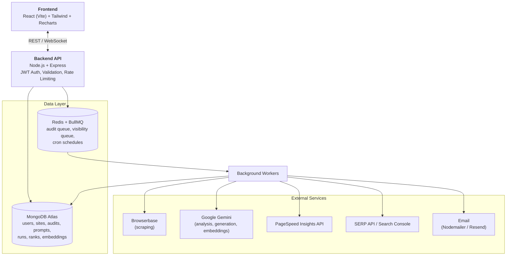
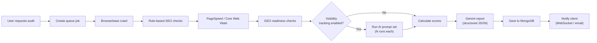
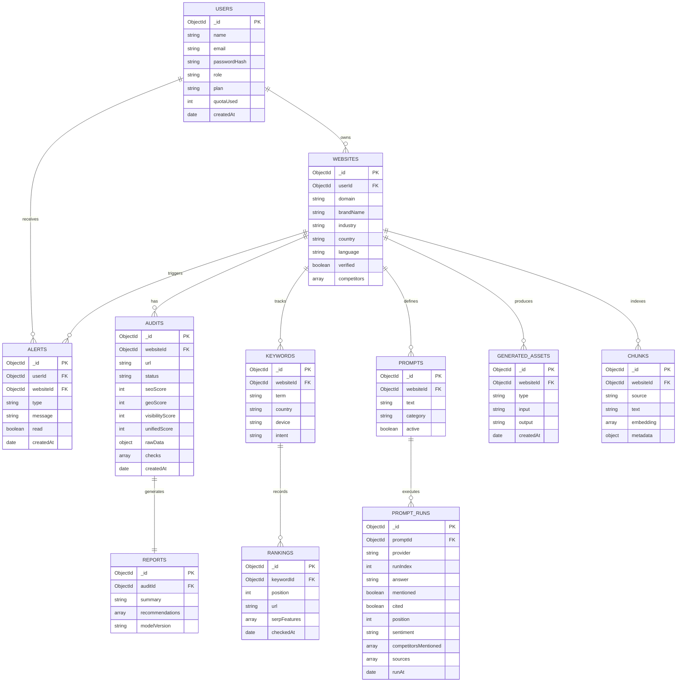

# VisibilityIQ: AI Search Visibility Platform (SEO + GEO + AEO)

**Document type:** Software Requirements Specification (SRS) + Product Requirements Document (PRD)
**Version:** 1.0 | **Date:** 28 Oct 2026
**Project type:** Major Project (Generative AI, MERN Stack)
**Prepared by:** Anshitva Mishra | **Team:** G26

---

## 1. Introduction

### 1.1 Purpose
This document defines the requirements for **VisibilityIQ**, a full-stack MERN web application that measures and improves how visible a website is across **traditional search engines (SEO)** and **AI-powered answer engines such as Gemini, ChatGPT-style assistants and AI Overviews (GEO/AEO)**.

### 1.2 Problem Background
Search behaviour is shifting. Users increasingly get answers directly from generative AI instead of clicking ten blue links. Existing SEO tools (Ahrefs, SEMrush, Screaming Frog) focus on classic ranking factors and are expensive, and almost none tell a site owner **"Does AI recommend or cite my website, and what should I change so it does?"**. Small businesses, students and freelancers have no affordable, unified tool for both worlds.

### 1.3 Definitions

| Term | Meaning |
|---|---|
| **SEO** | Search Engine Optimization: improving ranking in Google/Bing results |
| **GEO** | Generative Engine Optimization: improving the chance that AI models mention, cite or recommend your content |
| **AEO** | Answer Engine Optimization: optimizing for direct answers (featured snippets, voice, AI Overviews) |
| **AI Visibility Score** | Percentage of tested prompts in which the site/brand appears in an AI answer |
| **Share of Voice (SoV)** | Your mentions divided by total mentions (you + competitors) across tested prompts |
| **Citation** | An AI answer that links to or names your URL as a source |
| **E-E-A-T** | Experience, Expertise, Authoritativeness, Trustworthiness |
| **llms.txt** | A proposed file that gives AI crawlers a clean summary of a site |
| **RAG** | Retrieval-Augmented Generation |

### 1.4 Scope
**In scope:** user accounts, site management, automated SEO audit, GEO readiness audit, AI visibility tracking, keyword rank tracking, competitor benchmarking, AI-generated action plan, AI content/schema generator, RAG chat over audit history, scheduled monitoring, alerts, report export.

**Out of scope (v1):** backlink index crawling, paid ads management, mobile native apps, team billing/payments.

### 1.5 Intended Audience
Evaluators, project manager, developers, testers, and end users (marketers, site owners).

---

## 2. Overall Description

### 2.1 Product Perspective
A standalone, cloud-deployable web application with a React frontend, Node/Express REST API, MongoDB database, a Redis-backed job queue for long-running audits, and third-party integrations (Browserbase, Google Gemini, PageSpeed Insights, a SERP data API).

### 2.2 What Makes It Unique (USP)
1. **Unified Visibility Score** that combines SEO + GEO + AEO into one 0-100 number.
2. **AI Visibility Tracker** that actually asks LLMs real user-style questions and records whether you are mentioned or cited.
3. **GEO Readiness Audit** that checks AI-crawler access, llms.txt, structured data, answer-first content, entity clarity and E-E-A-T signals.
4. **Fix-it Generator** that does not just report problems; it writes the fix (rewritten sections, JSON-LD schema, FAQ blocks, llms.txt, robots.txt rules).
5. **"Ask Your Audit" chat** (RAG over your own audit history).
6. **Competitor Gap Analysis:** shows prompts where competitors are cited but you are not.
7. **Impact vs Effort prioritisation** of recommendations instead of a flat list.

### 2.3 User Classes

| Persona | Description | Main needs |
|---|---|---|
| **Site Owner / Freelancer** | Non-technical, owns 1-3 sites | Plain-language fixes, low cost |
| **Digital Marketer / Agency** | Manages many sites | Multi-site dashboard, exports, trends |
| **Content Writer** | Writes pages | Content rewrite suggestions, AI-citation tips |
| **Admin** | Platform owner | User management, usage and API-cost monitoring |

### 2.4 Operating Environment
Modern browsers (Chrome, Edge, Firefox, Safari). Backend on Node.js 20+. MongoDB Atlas. Redis. Deployed on Render/Railway/Vercel or similar.

### 2.5 Constraints
- LLM outputs are **non-deterministic**, so every visibility prompt is run multiple times (default 3) and a mention rate is reported.
- API rate limits and cost (Gemini, Browserbase, SERP API) require queueing, caching and per-user quotas.
- Scraping must respect robots.txt and applicable terms of service. Google results are fetched through a licensed SERP API or Google Search Console, **not** by scraping Google directly.

### 2.6 Assumptions
Users own or have permission to audit the submitted websites. Third-party API keys are available (free tiers acceptable for development).

---

## 3. Functional Requirements

Priority: **P1** = must have (MVP), **P2** = should have, **P3** = nice to have.

### 3.1 Authentication and User Management
| ID | Requirement | Priority |
|---|---|---|
| FR-1.1 | Users can register with email and password; passwords hashed (bcrypt) | P1 |
| FR-1.2 | Login issues JWT access token + refresh token (httpOnly cookie) | P1 |
| FR-1.3 | Password reset via emailed link | P2 |
| FR-1.4 | Role-based access (User, Admin) | P1 |
| FR-1.5 | Google OAuth login | P3 |

### 3.2 Website Management
| ID | Requirement | Priority |
|---|---|---|
| FR-2.1 | Add, edit, delete websites (domain, brand name, industry, target country/language) | P1 |
| FR-2.2 | Verify ownership (meta tag or DNS TXT) before enabling monitoring | P2 |
| FR-2.3 | Add up to N competitors per website | P1 |
| FR-2.4 | Per-plan limits on number of sites/audits (quota enforcement) | P2 |

### 3.3 SEO Audit Engine
| ID | Requirement | Priority |
|---|---|---|
| FR-3.1 | Crawl a URL (and optionally up to N internal pages) using Browserbase headless browser, including JS-rendered content | P1 |
| FR-3.2 | Check title tag, meta description, canonical, robots meta, headings (H1-H6) hierarchy, image alt text, internal/external/broken links, Open Graph/Twitter tags | P1 |
| FR-3.3 | Fetch Core Web Vitals and mobile-friendliness via PageSpeed Insights API | P1 |
| FR-3.4 | Validate structured data (JSON-LD, Microdata) and report errors | P1 |
| FR-3.5 | Check robots.txt, sitemap.xml, HTTPS, redirects | P2 |
| FR-3.6 | Produce a per-category SEO score (0-100) | P1 |

### 3.4 GEO Readiness Audit (new)
| ID | Requirement | Priority |
|---|---|---|
| FR-4.1 | Detect whether AI crawlers (GPTBot, ClaudeBot, PerplexityBot, Google-Extended, CCBot) are allowed or blocked in robots.txt | P1 |
| FR-4.2 | Check presence and quality of `llms.txt` | P2 |
| FR-4.3 | Evaluate **answer-first content**: direct definitions, summaries at top, Q&A formatting, concise paragraphs | P1 |
| FR-4.4 | Check FAQ, HowTo, Article, Organization, Product schema coverage | P1 |
| FR-4.5 | Score **E-E-A-T signals**: author bio, publish/update dates, About/Contact page, citations to sources, reviews | P1 |
| FR-4.6 | Score **entity clarity**: consistent brand name, `sameAs` links, Wikipedia/Wikidata/LinkedIn presence | P2 |
| FR-4.7 | Check content "extractability": statistics, quotable facts, tables, lists, headings phrased as questions | P2 |
| FR-4.8 | Produce a GEO Readiness Score (0-100) with an explanation for each sub-score | P1 |

### 3.5 AI Visibility Tracker (new, core differentiator)
| ID | Requirement | Priority |
|---|---|---|
| FR-5.1 | Auto-generate 20-50 realistic user prompts for the site's niche using Gemini (e.g., "best project management tool for startups") | P1 |
| FR-5.2 | User can add, edit, remove and categorise prompts (informational, comparison, transactional, branded) | P1 |
| FR-5.3 | Run each prompt on the Gemini API (with Google Search grounding where available) N times and store full answers | P1 |
| FR-5.4 | Detect brand mention, URL citation, position within the answer, and sentiment (positive/neutral/negative) | P1 |
| FR-5.5 | Compute AI Visibility Score, Citation Rate and **Share of Voice** vs competitors | P1 |
| FR-5.6 | Support additional LLM providers through a pluggable adapter interface (OpenAI, Perplexity, Claude) | P3 |
| FR-5.7 | **Gap Analysis:** list prompts where competitors are mentioned but the user is not, with reasons | P2 |
| FR-5.8 | Show which sources AI engines cite most in the niche (opportunities for outreach/content) | P2 |

### 3.6 Keyword Rank Tracking
| ID | Requirement | Priority |
|---|---|---|
| FR-6.1 | Add keywords per site with country/device settings | P1 |
| FR-6.2 | Fetch positions via SERP API (or Google Search Console integration) on a schedule | P1 |
| FR-6.3 | Show historical rank trends as line charts and position-change indicators | P1 |
| FR-6.4 | AI keyword suggestions and clustering by intent | P2 |
| FR-6.5 | Detect SERP features (featured snippet, People Also Ask, AI Overview presence) | P3 |

### 3.7 AI Insights and Recommendations (Gemini)
| ID | Requirement | Priority |
|---|---|---|
| FR-7.1 | Convert raw audit + GEO + visibility data into a readable report with executive summary | P1 |
| FR-7.2 | Recommendations ranked on an **Impact vs Effort** matrix (Quick Wins, Big Bets, Fill-ins, Skip) | P1 |
| FR-7.3 | Each recommendation includes: what, why it matters, how to fix, and a code/text example | P1 |
| FR-7.4 | Structured JSON output from Gemini validated against a schema (with retry on invalid output) | P1 |
| FR-7.5 | Compare latest audit to previous and highlight improvements/regressions | P2 |

### 3.8 Fix-it Generator (new)
| ID | Requirement | Priority |
|---|---|---|
| FR-8.1 | Generate ready-to-paste **JSON-LD schema** (FAQ, Article, Organization, Product) | P1 |
| FR-8.2 | Rewrite title/meta/heading/intro content in an AI-citation-friendly style, with before/after view | P1 |
| FR-8.3 | Generate FAQ section from page content | P2 |
| FR-8.4 | Generate `llms.txt` and recommended `robots.txt` AI-crawler rules | P2 |
| FR-8.5 | Content gap suggestions: topics/questions competitors answer that the user does not | P3 |

### 3.9 Ask Your Audit: RAG Chat (new)
| ID | Requirement | Priority |
|---|---|---|
| FR-9.1 | Store audit findings and AI answers as embeddings (MongoDB Atlas Vector Search) | P2 |
| FR-9.2 | Chat interface to ask questions such as "Why did my score drop last week?" or "What should I fix first?" | P2 |
| FR-9.3 | Answers must cite the audit records used (grounded, no hallucinated data) | P2 |

### 3.10 Dashboard, Monitoring and Alerts
| ID | Requirement | Priority |
|---|---|---|
| FR-10.1 | Dashboard with Unified Visibility Score, SEO/GEO/AEO sub-scores, trend charts, top issues | P1 |
| FR-10.2 | Scheduled audits and visibility runs (daily/weekly) via job queue | P2 |
| FR-10.3 | Email alerts for score drops, ranking loss, or lost AI citations | P2 |
| FR-10.4 | Audit history list with filters and side-by-side comparison | P1 |
| FR-10.5 | Real-time audit progress (Socket.IO or SSE) | P2 |

### 3.11 Reports and Export
| ID | Requirement | Priority |
|---|---|---|
| FR-11.1 | Save every report to history | P1 |
| FR-11.2 | Export as PDF; CSV for raw data | P1 |
| FR-11.3 | Shareable read-only public link with expiry | P3 |
| FR-11.4 | White-label PDF (agency logo) | P3 |

### 3.12 Admin
| ID | Requirement | Priority |
|---|---|---|
| FR-12.1 | View users, usage, failed jobs | P2 |
| FR-12.2 | Monitor API cost per user, set quotas | P3 |

---

## 4. Scoring Model

**Unified Visibility Score = 0.40 × SEO + 0.35 × GEO Readiness + 0.25 × AI Visibility**
(weights are configurable in settings and justified in the project report).

| Sub-score | Inputs |
|---|---|
| SEO | On-page, technical, performance, mobile, structured data |
| GEO Readiness | AI-crawler access, llms.txt, answer-first content, schema, E-E-A-T, entity clarity |
| AI Visibility | Mention rate, citation rate, sentiment, share of voice from prompt runs |

---

## 5. Non-Functional Requirements

| Category | Requirement |
|---|---|
| **Performance** | Dashboard loads in < 3 s; a single-page audit completes in < 60 s; long jobs run asynchronously |
| **Scalability** | Stateless API; BullMQ workers can scale horizontally |
| **Security** | HTTPS, bcrypt, JWT with refresh rotation, input validation (Joi/Zod), rate limiting, Helmet, CORS whitelist, NoSQL-injection sanitisation, SSRF protection (block private IP ranges when fetching user URLs), secrets in environment variables |
| **Reliability** | Job retries with exponential backoff; graceful handling of API failures; 99% availability target for demo deployment |
| **Usability** | Responsive UI, plain-language explanations, accessibility (WCAG AA basics), dark/light theme |
| **Maintainability** | Modular code, ESLint/Prettier, API documented with Swagger/OpenAPI, README and setup scripts |
| **Cost control** | Cache repeated results, per-user quotas, token usage logging |
| **Privacy** | Only store data necessary; user can delete a site and all its data; no personal data sent to LLMs |
| **AI quality** | Prompt versioning, JSON-schema validation, temperature controls, repeated runs to reduce variance |

---

## 6. System Architecture

**Pipeline for one audit:**

---

## 7. Data Model (MongoDB Collections)

---

## 8. Key REST API Endpoints

| Method | Endpoint | Purpose |
|---|---|---|
| POST | `/api/auth/register`, `/login`, `/refresh`, `/logout` | Auth |
| CRUD | `/api/websites` | Manage sites and competitors |
| POST | `/api/audits` | Start audit job |
| GET | `/api/audits/:id` | Status, results, scores |
| GET | `/api/audits/:id/report` | AI report |
| POST | `/api/geo/analyze` | Run GEO readiness checks |
| POST | `/api/visibility/prompts/generate` | AI-generated prompt set |
| POST | `/api/visibility/run` | Run visibility tracking |
| GET | `/api/visibility/summary/:websiteId` | Score, SoV, gaps |
| CRUD | `/api/keywords`, GET `/api/keywords/:id/history` | Rank tracking |
| POST | `/api/generate/schema`, `/faq`, `/llmstxt`, `/rewrite` | Fix-it generator |
| POST | `/api/chat` | RAG chat |
| GET | `/api/reports/:id/export?format=pdf\|csv` | Export |

---

## 9. User Stories and Acceptance Criteria

| ID | User story | Acceptance criteria |
|---|---|---|
| US-1 | As a site owner, I want to run an SEO audit on my site so I know what to fix | Audit completes, shows score and categorised issues, saved in history |
| US-2 | As a marketer, I want to see whether AI mentions my brand so I can measure GEO | Visibility score, mention/citation rate and per-prompt answers displayed |
| US-3 | As a marketer, I want to compare against competitors | Share-of-voice chart and gap list shown |
| US-4 | As a site owner, I want ready-made fixes | Generated schema validates in Google Rich Results Test; rewrite shows before/after |
| US-5 | As a user, I want to track keyword movement | Line chart with position history and change delta |
| US-6 | As a user, I want alerts when things get worse | Email sent within 15 min of detecting a drop above threshold |
| US-7 | As a user, I want to ask questions about my audits | Chat answer cites at least one stored audit record |
| US-8 | As a user, I want to export reports | PDF downloads with scores, charts and recommendations |

---

## 10. Technology Stack

| Layer | Technology |
|---|---|
| Frontend | React 18, Vite, Tailwind CSS, React Router, Recharts, TanStack Query |
| Backend | Node.js, Express, Mongoose, Zod/Joi, BullMQ, node-cron, Socket.IO |
| Database | MongoDB Atlas (with Vector Search), Redis |
| AI | Google Gemini API (analysis, generation, embeddings); adapter layer for other LLMs |
| Scraping | Browserbase (Playwright/Puppeteer sessions), Cheerio for parsing |
| Data APIs | PageSpeed Insights, SERP API / Google Search Console |
| Reports | Puppeteer or PDFKit for PDF |
| DevOps | Git/GitHub, GitHub Actions CI, Docker, Render/Vercel |
| Testing | Jest, Supertest, React Testing Library, Playwright E2E |

---

## 11. Development Roadmap (Suggested 16 Weeks)

| Phase | Weeks | Deliverables |
|---|---|---|
| 1. Planning and design | 1-2 | SRS, wireframes, DB schema, API design |
| 2. Foundation | 3-4 | Auth, website CRUD, project setup, CI |
| 3. SEO audit engine | 5-7 | Browserbase crawl, checks, PageSpeed, scoring |
| 4. AI reporting | 8-9 | Gemini structured reports, impact/effort matrix, history |
| 5. GEO + AI visibility | 10-12 | GEO audit, prompt generator, visibility runs, SoV, gap analysis |
| 6. Rank tracking + monitoring | 13 | Keywords, SERP integration, schedules, alerts |
| 7. Fix-it generator + RAG chat | 14 | Schema/FAQ/llms.txt/rewrite, chat |
| 8. Testing, polish, docs, deployment | 15-16 | Test suite, PDF export, deployment, final report and demo |

**MVP cut (if time is short):** FR-1.x, 2.x, 3.x, 4.1/4.3/4.4/4.5/4.8, 5.1-5.5, 6.x (P1), 7.1-7.4, 8.1-8.2, 10.1, 10.4, 11.1-11.2.

---

## 12. Risks and Mitigation

| Risk | Impact | Mitigation |
|---|---|---|
| LLM answers vary between runs | Unreliable metrics | Multiple runs, report rate with confidence range, store raw answers |
| API cost/rate limits | Service stops | Queue, cache, quotas, free-tier fallbacks |
| Sites block scraping | Incomplete audits | Browserbase stealth/proxy, respect robots.txt, show partial results with explanation |
| SERP data cost | Rank tracking limited | Use Search Console for owned sites, cap keywords per user |
| Gemini returns malformed JSON | Report fails | Schema validation + retry + fallback template |
| Scope too large | Missed deadline | MVP cut defined in Section 11 |
| SSRF / abuse via URL input | Security breach | URL validation, private-IP blocking, rate limits |

---

## 13. Testing Strategy

- **Unit:** scoring functions, parsers, mention/citation detection.
- **Integration:** API routes, queue workers, DB operations (mock third-party APIs).
- **E2E:** register → add site → audit → view report → export.
- **AI evaluation:** fixed test set of 30 prompts to check JSON validity, mention-detection accuracy (manually labelled sample), and recommendation relevance.
- **Security:** OWASP Top 10 checklist, dependency audit.
- **Performance:** load test audit queue with concurrent jobs.

---

## 14. Success Metrics

- Audit success rate above 95%.
- Mention-detection accuracy above 90% on the labelled sample.
- Median audit time under 60 seconds per page.
- Generated schema passes validation in at least 90% of cases.
- At least 5 real websites audited and improved as a case study (before/after score).

---

## 15. Future Scope

Browser extension, Slack/WhatsApp alerts, multi-language GEO, Perplexity/ChatGPT/Claude live tracking via official APIs, backlink and digital-PR suggestions, team workspaces with billing, WordPress plugin for one-click fixes.

---

## 16. Final Problem Statement

> Website owners and marketers rely on fragmented, costly tools that measure only classic search ranking, while a growing share of users now get answers directly from generative AI engines. No affordable, unified system tells them how visible their website is in both traditional search results and AI-generated answers, nor helps them fix it. **VisibilityIQ** is a MERN-based, generative-AI platform that automatically audits on-page and technical SEO using headless browser automation, evaluates Generative Engine Optimization readiness, tracks keyword rankings and brand mentions/citations across AI answers over time, benchmarks against competitors, and uses Google Gemini to produce prioritised, plain-language action plans along with ready-to-use fixes (schema, FAQs, rewritten content, llms.txt), all inside a secure multi-user dashboard with saved history, alerts and exportable reports.

## 17. Objectives

1. Automate SEO and GEO auditing that is otherwise manual and expensive.
2. Measure and track brand visibility inside AI-generated answers (mention rate, citation rate, share of voice).
3. Track keyword position changes and visibility trends over time.
4. Convert technical data into prioritised, plain-language recommendations using generative AI.
5. Generate implementable fixes, not just diagnostics.
6. Provide a secure, scalable, multi-user dashboard with history, alerts and exports.
